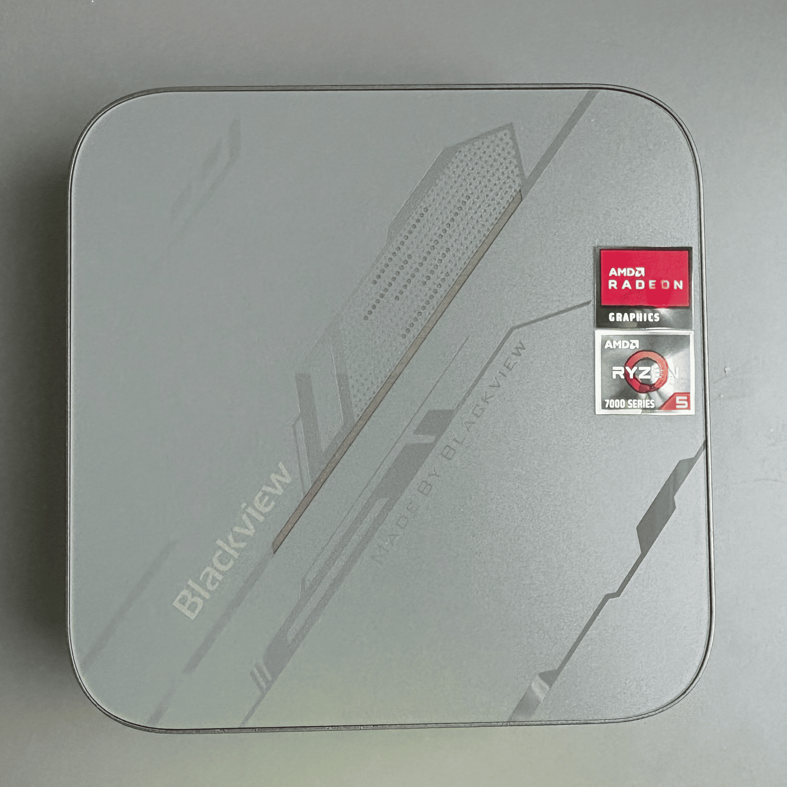

# Homelab

Configuration and documentation for the homelab I run at home. It is a very humble environment with few services, but it has served as a lab for getting hands-on with systems administration and hosting interesting services.

## Device

| Feature | Description |
|---|---|
| Model | Blackview MP100 |
| Processor (CPU) | AMD Ryzen™ 5 7430U · 6 cores · 12 threads · Max boost 4.3 GHz |
| GPU | AMD Radeon™ Graphics (7 cores · 1800 MHz) |
| RAM | 16 GB DDR4 |
| Storage | 512 GB SSD M.2 2280 PCIe 3.0 |
| Operating System | Proxmox VE |

### Display and Graphics

| Output | Resolution |
|---|---|
| HDMI 2.0b | 4K @ 60 Hz ×1 |
| DisplayPort 1.4 | 4K @ 144 Hz ×1 |
| USB-C full-featured | ×2 (10 Gbps · 4K @ 60 Hz output) |

### Connectivity

| Type | Description |
|---|---|
| Wi-Fi | Wi-Fi 6 (802.11 a/b/g/n/ac/ax) |
| Bluetooth | Integrated (2.4G / 5G) |
| Ethernet | Gigabit LAN 10/100/1000 Mbps (auto-adaptive) |

### Ports and Interfaces

| Port | Description |
|---|---|
| USB 2.0 Type-A | ×1 (480 Mbps) |
| USB 3.2 Gen 2 Type-A | ×2 (10 Gbps) |
| USB-C | ×2 full-featured (10 Gbps + 4K @ 60 Hz) |
| DisplayPort | Up to 4K 144 Hz |
| HDMI 2.0 | Up to 4K 60 Hz |
| RJ45 Gigabit | ×1 (1000 Mbps) |
| 3.5 mm audio jack | Two-in-one |
| DC Jack IN | 5.5 × 2.1 mm |

### Dimensions and Weight

| Feature | Description |
|---|---|
| Dimensions | 127 × 127 × 45 mm |
| Weight | 492 g |

### Power

| Feature | Description |
|---|---|
| Power supply | Input 100–240V 50/60 Hz · Output 19V/3.42A (DC 5.5 × 2.1 mm) |

## Services

<table>
    <tr>
        <th>Icon</th>
        <th>Name</th>
        <th>Description</th>
    </tr>
    <tr>
        <td></td>
        <td><a href="https://proxmenux.com/">ProxMenux</a></td>
        <td>Interactive menu and web dashboard to manage and configure Proxmox VE easily</td>
    </tr>
    <tr>
        <td></td>
        <td><a href="https://tailscale.com/">Tailscale</a></td>
        <td>Private remote access network (WireGuard-based mesh VPN) to connect to the homelab from outside the house</td>
    </tr>
    <tr>
        <td></td>
        <td><a href="https://pi-hole.net/">Pi-hole</a></td>
        <td>Local DNS server that blocks ads and trackers at the network level</td>
    </tr>
    <tr>
        <td></td>
        <td><a href="https://nginxproxymanager.com/">Nginx Proxy Manager</a></td>
        <td>Reverse proxy with a web interface to manage domains, subdomains, and SSL certificates for internal services</td>
    </tr>
    <tr>
        <td></td>
        <td><a href="https://github.com/dani-garcia/vaultwarden">Vaultwarden</a></td>
        <td>Self-hosted password manager, compatible with the official Bitwarden clients</td>
    </tr>
</table>
